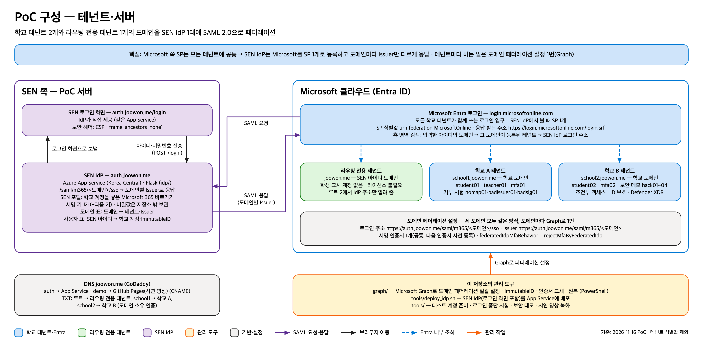
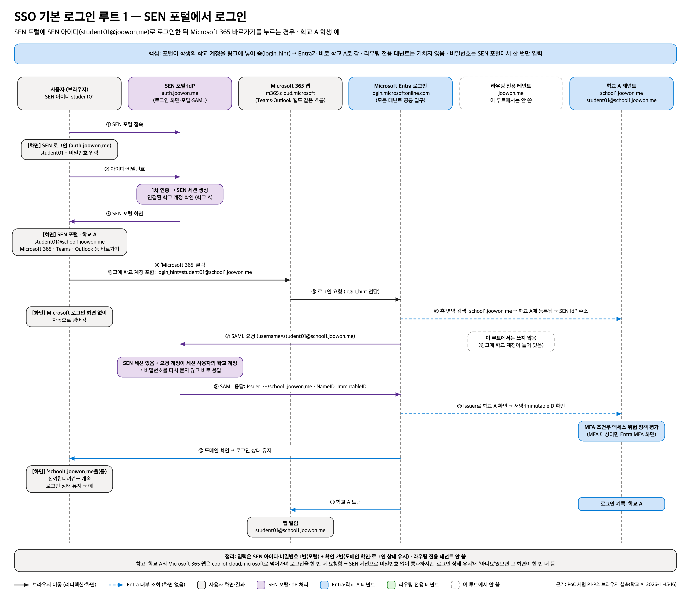
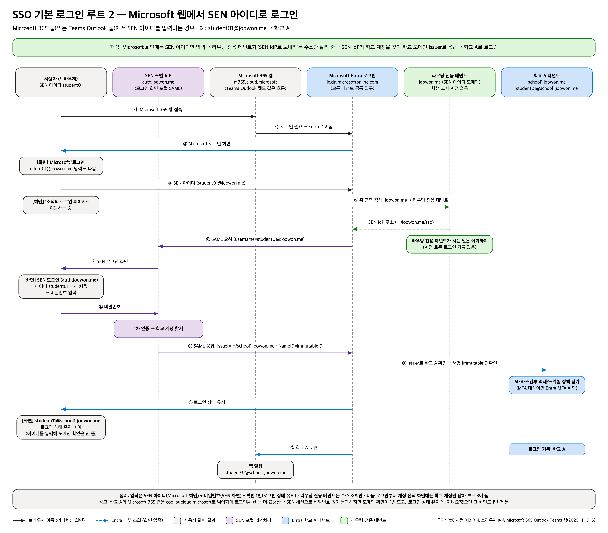
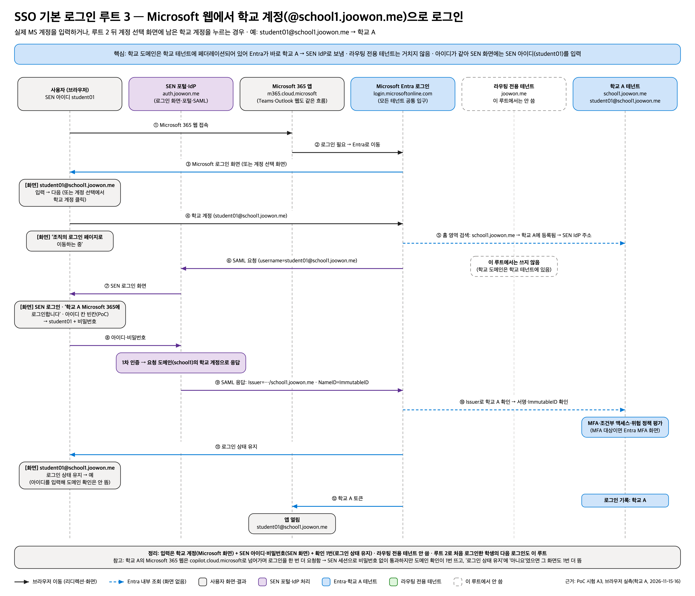

# SEN – Microsoft 365 SSO PoC

학교별 Microsoft 365 테넌트를 그대로 두고 SEN IdP 한 벌로 SSO하는 방식을 실제 테넌트에서 검증했다. 시연 영상은 https://demo.joowon.me 에 있다.

## 1. 결론

1. 학교 테넌트의 커스텀 도메인을 SEN IdP에 SAML 2.0으로 페더레이션하면 IdP 1대와 서명 인증서 1개로 여러 학교 테넌트에 SSO할 수 있다. Microsoft 쪽 SP는 모든 테넌트에 공통이고, 도메인마다 IdP의 Issuer만 다르게 둔다.
2. SEN은 1차 인증(아이디·비밀번호)만 하고, MFA는 학교 테넌트의 Entra가 한다(`rejectMfaByFederatedIdp`).
3. 학생은 SEN 아이디만 알면 된다. 학교 계정 아이디는 SEN 아이디와 같다(`student01@joowon.me` ↔ `student01@school1.joowon.me`). 한 사람의 학교 계정은 학교 테넌트 1곳에만 있고, SEN이 이를 관리한다.
4. Microsoft 로그인 화면에 SEN 아이디를 입력하는 로그인(루트 2)은 SEN 아이디 도메인을 학생 계정이 없는 라우팅 전용 테넌트에 페더레이션해서 동작한다. 루트 1·3만 쓰면 이 테넌트는 필요 없다.
5. 토큰 발급, 로그인 기록, MFA, 조건부 액세스, 위험 탐지는 모두 학생의 학교 테넌트에서 처리된다.

## 2. PoC 구성



| 구성 | 역할 | 페더레이션 도메인 | 계정 |
|---|---|---|---|
| 학교 A 테넌트 | 학생·교사 계정, 토큰 발급 | `school1.joowon.me` | PoC 계정 |
| 학교 B 테넌트 | 학생·교사 계정, 토큰 발급, 보안 데모 | `school2.joowon.me` | PoC 계정(보안 데모 포함) |
| 라우팅 전용 테넌트 | SEN 아이디 도메인 등록 | `joowon.me` | 학생·교사 계정 없음 |
| Azure App Service(Korea Central) | SEN IdP 실행(로그인 화면 포함) | — | — |

- **라우팅 전용 테넌트:** 학생·교사 계정과 라이선스 없이 SEN 아이디 도메인만 등록한다. 라우팅 설정(페더레이션)은 이 테넌트 관리자만 바꿀 수 있어, 학교 테넌트 관리자는 전체 학생의 SEN 아이디 로그인 경로를 바꿀 수 없다.
- **주소**
  - `auth.joowon.me`: SEN IdP(SEN 로그인 화면 `/login`, SAML, SEN 포털)
  - `demo.joowon.me`: 시연 영상(기본 SSO, 거부, SEN 아이디 라우팅, 보안 데모, 관리 포털)
- **테스트 계정**
  - 학생·교사: `student01`·`student02`·`teacher01`
  - MFA 필수: `mfa01`·`mfa02`
  - 거부 시험: `nomap01`·`badissuer01`·`badsig01`
  - 보안 데모: `hack01`~`hack04`

## 3. 핵심 설계

| 항목 | 내용 |
|---|---|
| 테넌트 구분 | 모든 테넌트가 같은 SP 식별값(`urn:federation:MicrosoftOnline`)을 쓰고 SAML 요청에 사용자 정보가 없다. 그래서 IdP는 로그인 주소의 도메인(`/saml/m365/<도메인>/sso`)으로 학교를 구분한다 |
| 도메인별 Issuer | Entra가 도메인마다 고유한 Issuer를 요구한다. IdP는 `https://auth.joowon.me/saml/m365/<도메인>`을 쓴다 |
| SAML 응답 | NameID=ImmutableID, IDPEmail=학교 계정 UPN, AuthnContext=PasswordProtectedTransport |
| 인증 역할 | SEN은 1차 인증만 한다. 모든 도메인에 `rejectMfaByFederatedIdp` |
| 아이디 | SEN 아이디 = 학교 계정 앞부분이며 전 학교 테넌트에서 유일하다. 학교 계정은 학교 테넌트 1곳에만 만든다(두 테넌트에 계정이 생기지 않게 SEN이 관리) |
| SEN 아이디 라우팅 | IdP가 SEN 아이디에 연결된 학교 계정을 찾아 그 학교 도메인의 Issuer로 응답한다. 라우팅 도메인 Issuer로 응답하면 거부된다(R11) |
| 늘지 않는 것 | IdP 대수, 서명 인증서(1개를 모든 도메인에 등록), Microsoft 쪽 SP |
| 일괄 설정 | Graph `POST /domains/{id}/federationConfiguration` 스크립트. 인증서 교체는 `nextSigningCertificate` 사전 등록 → IdP 서명 전환 → 테넌트별 승격 |

## 4. SSO 기본 로그인 루트 3가지







| 항목 | 루트 1: SEN 포털 | 루트 2: MS 웹 + SEN 아이디 | 루트 3: MS 웹 + 학교 계정 |
|---|---|---|---|
| 시작 | SEN 포털 로그인 → Microsoft 365 바로가기 | `student01@joowon.me` 입력 | 실제 MS 계정 `student01@school1.joowon.me` 입력(또는 계정 선택 화면) |
| 홈 영역 검색 | `school1` → 학교 A(바로가기의 `login_hint`) | `joowon.me` → 라우팅 전용 테넌트 | `school1` → 학교 A |
| SEN 로그인 화면 | 포털 로그인 때 한 번 | 아이디 미리 채움 | '학교 A' 표시, 아이디 빈칸(PoC) |
| Microsoft 확인 화면 | 도메인 확인 + 로그인 상태 유지 | 로그인 상태 유지 | 로그인 상태 유지 |
| 라우팅 전용 테넌트 | 안 씀 | IdP 주소 조회만 | 안 씀 |
| 토큰·기록·MFA | 학교 A | 학교 A | 학교 A |
| 근거 | P1·P2, 브라우저 실측 | R13·R14, 브라우저 실측 | A3, 브라우저 실측 |

확인한 동작:

- 페더레이션된 도메인이면 Entra는 계정이 있는지 보지 않고 도메인만 보고 SEN 로그인 화면으로 보낸다.
- Microsoft 세션이 있으면 대개 SEN을 거치지 않는다. 앱이 다시 요청하면 SEN을 한 번 거치지만, SEN 세션이 있으면 비밀번호 없이 통과한다.
- 루트 2로 처음 로그인하면 다음부터 계정 선택 화면에는 학교 계정만 남는다. 그래서 반복 로그인은 대부분 루트 3이다.
- 비밀번호는 세 루트 모두 SEN 화면에서만 입력한다. MFA 대상 계정은 SEN 로그인 뒤 Entra MFA를 거친다.
- 학교 A의 Microsoft 365 웹은 `copilot.cloud.microsoft`로 넘어가면서 로그인을 한 번 더 요청한다. SEN 세션이 있어 비밀번호 없이 통과하지만 확인 화면이 더 뜬다.
  - 루트 2·3에서는 도메인 확인 화면이 1번 추가로 뜬다.
  - '로그인 상태 유지'에 '아니요'를 골랐으면 그 화면도 1번 더 뜬다.
- 라우팅 전용 테넌트는 홈 영역 검색에서 SEN IdP 주소만 알려 준다. 이 테넌트에는 토큰 발급과 로그인 기록이 없고(0건), 이 테넌트를 지정한 앱 요청은 거부된다(AADSTS50020, R6).
- 라우팅 도메인(`joowon.me`)을 다른 테넌트로 옮기자 홈 영역 검색이 안정되기까지 약 28분 동안 SEN 아이디 입력 로그인이 간헐적으로 실패했다. 학교 계정 입력은 영향이 없었다.

## 5. 검증 결과

### 5.1 기본 SSO와 거부

- **학교 계정과 포털:** 학교 계정 로그인과 포털 바로가기 모두 성공했다.
- **거부:** 위조·오류는 모두 거부됐다.
  - 등록 안 된 Issuer: AADSTS50107
  - 서명 변조: AADSTS500069
  - ImmutableID 없음: AADSTS90019·90072
- **재인증 요구:** 앱의 재인증 요구(`prompt=login`)는 IdP에 전달되지 않는다. 재인증 주기는 IdP 세션 수명으로 통제한다.
- **인증서 교체:** 두 테넌트 모두 성공했다.
- **Entra 요청 형식:** 서명 없는 POST 요청이고, 폼에 `username`이 들어 있다.
- **IdP 구현 요건:** SAML 응답 자동 전송 화면에는 CSP `form-action`을 제한하지 않는다.

### 5.2 MFA 역할: Entra가 수행

- MFA 대상이 아닌 계정은 SEN 로그인만으로 끝난다.
- 처음 로그인할 때 Microsoft 등록 화면에서 인증 앱을 등록한다(C6). 등록 뒤에는 인증 앱 코드를 입력한다(C7·C8·R12, `mfa02@joowon.me` 포함).
- 로그인 로그에는 "MFA completed in Azure AD"로 남는다.
- 인증 수단은 학교 테넌트 계정에 등록된다. 전학으로 다른 학교 테넌트에 계정이 새로 생기면 다시 등록해야 한다.

### 5.3 보안 데모(학교 B)

| ID | 시나리오 | 결과 |
|---|---|---|
| S1 | Tor 로그인 → 차단 정책 | 차단(AADSTS53003) |
| S2 | Tor 로그인 → MFA 요구 정책 | Entra MFA 뒤 성공, 위험 자동 해소 |
| S3 | Tor 로그인, MFA 수단 없음 | 차단(AADSTS53004) |
| S4 | 관리자 침해 확인 | CAE로 5.8~8.6분 뒤 기존 토큰 거부 |
| S5 | Defender XDR 인시던트 | 3~5분 뒤 사용자별 인시던트, MFA로 해소되면 자동 해결 |

- S0(대조군)과 V1~V5(관리 포털 화면)도 녹화했다.
- 비밀번호 기반 탐지는 적용되지 않으므로 비밀번호 공격 방어는 SEN IdP가 맡는다.

## 6. 운영 설계 요건

**SEN IdP·계정 관리(수행사)**

1. SEN 아이디 1개에는 학교 테넌트 계정 1개만 연결한다. 두 테넌트에 같은 계정이 생기지 않게 관리한다.
2. 학생 학교 도메인의 Issuer로 응답한다.
3. Entra가 넘긴 `username`과 세션 사용자를 비교한다.
4. 학교 도메인 요청에도 아이디를 채우고, 아이디의 도메인은 떼고 처리한다.
5. 연결된 학교 계정이 없으면 안내 화면을 보여 준다.
6. 실패 제한은 계정 단위로 둔다.
7. 세션 수명과 로그아웃 연동(SLO)을 정한다.
8. 서명키를 정기 교체한다.
9. SAML 응답 화면의 CSP를 위 5.1대로 둔다.

**학교 테넌트**

1. 계정은 페더레이션된 학교 도메인으로 만들고 ImmutableID를 지정한다.
2. `rejectMfaByFederatedIdp`를 두고, MFA 요구는 조건부 액세스로 건다.
3. 전학·졸업 처리를 SEN과 동기화한다.
4. 보안은 아래 8.5 '운영 보안 기준'을 따른다.

**라우팅 전용 테넌트(교육청)**

1. 학생 계정과 라이선스 없이 `senedu.kr`만 등록한다.
2. 루트 2에만 필요하다.
3. 관리자 권한을 최소로 둔다.
4. 도메인을 옮길 때는 약 30분 점검 시간을 둔다.

## 7. PoC와 운영 대응

| PoC | 운영 |
|---|---|
| `joowon.me` | `senedu.kr` |
| 라우팅 전용 테넌트 | 교육청 소유 `senedu.kr` 테넌트. NIA의 'senedu.kr 매핑 테넌트'에 해당하며, 루트 2에서 필요 |
| 학교 A·B | 학교별 Education 테넌트 약 1,400개 |
| `school1`·`school2.joowon.me` | 각 학교의 검증된 커스텀 도메인 |
| `auth.joowon.me` | 수행사 SEN IdP(로그인 화면 포함) |
| `graph/` 스크립트 | 약 1,400개 도메인 일괄 설정 |

Microsoft 365는 모든 학교 테넌트에 공통인 SP 하나라서, SEN IdP에 학교마다 SP를 등록하지 않는다. 학교마다 다른 것은 도메인별 Issuer와 각 테넌트의 도메인 페더레이션 설정뿐이다.
반면 SEN스쿨이 Graph로 학습데이터를 연계하면 학교 테넌트마다 관리자 동의가 필요하다. 이것은 SSO와 별개다.

## 8. 참고

### 8.1 시험 목록

본문에 근거로 쓴 시험이다. 로그인 종단 시험은 `tools/e2e_signin.py`(Microsoft 로그인부터 토큰 발급까지 실제 테넌트에서 HTTP로 진행), 실제 웹앱 확인은 `tools/browser_route_demo.py`(헤드리스 Chrome)로 했다.

| ID | 시나리오 | 결과 |
|---|---|---|
| A1 | 앱 시작(`domain_hint`) → 학교 A | 성공, 토큰 테넌트 = 학교 A |
| A2 | 앱 시작(`login_hint`) → 학교 B | 성공, 토큰 테넌트 = 학교 B |
| A3 | Microsoft 로그인 화면에 학교 계정 직접 입력 | 성공 |
| B2a | 등록 안 된 Issuer | 거부(AADSTS50107) |
| B2b | 서명 변조 | 거부(AADSTS500069) |
| C1 / C1b | Entra 쪽 ImmutableID 없음 | 거부(AADSTS90019 / 테넌트 지정 시 AADSTS90072) |
| C6 | 등록한 인증 수단이 없는 MFA 대상 계정 | 로그인 중 Microsoft 등록 화면에서 인증 앱을 등록한 뒤 로그인 |
| C7 / C8 | MFA 필수 계정(학교 A `mfa01`, 학교 B `mfa02`) | SEN 로그인 뒤 Entra가 인증 앱 코드를 요구, 성공 |
| F0 → F1 | 앱이 재인증(`prompt=login`) 요구 | IdP에 전달되지 않음, IdP 세션으로 바로 통과 |
| P1 / P2 | SEN 포털 바로가기 → Microsoft 365 웹 | 성공(학교 A / 학교 B) |
| 인증서 교체 | IdP 서명을 다음 인증서로 전환(테넌트에는 다음 인증서만 등록된 상태) | 두 테넌트 모두 성공 |
| R5 | 학교 B 테넌트를 지정한 앱(SharePoint처럼 테넌트 고정 주소)에 SEN 아이디 입력 | 성공 |
| R6 | 라우팅 테넌트를 지정한 앱에 학교 B 학생 | 거부(AADSTS50020) |
| R7 | 공용 PC: 앞 학생의 SEN 세션이 남은 브라우저에서 다른 학생이 SEN 아이디 입력 | IdP가 `username`과 세션 사용자를 비교해 다시 로그인 요구, 입력한 학생으로 로그인 |
| R8a | 무음 SSO(`prompt=none`) + SEN 아이디 힌트 | AADSTS50058(로그인된 계정과 힌트가 다름) 뒤 대화형 로그인 |
| R8b / R8c | 무음 SSO + 학교 계정 힌트 / 힌트 없음 | 성공 |
| R9 / R10 | 포털 링크 `domain_hint=joowon.me` / Microsoft 365 웹 `login_hint=SEN 아이디` | 성공 |
| R11 | 잘못된 구현: IdP가 라우팅 도메인 Issuer로 응답 | 거부(AADSTS90072. 라우팅 도메인이 학교 테넌트에 있을 때는 AADSTS5000820) |
| R12 | MFA 필수 계정(`mfa02`)이 SEN 아이디로 로그인 | 학교 B 계정의 Entra MFA(인증 앱 코드) 뒤 성공 |
| R13 / R14 | Microsoft 로그인 화면에 SEN 아이디 입력(`student01@joowon.me`, `student02@joowon.me`) | 성공(학교 A / 학교 B), SEN 로그인 화면에 아이디가 미리 채워짐 |
| 브라우저 | Outlook 웹·Teams 웹·Microsoft 365 웹에 SEN 아이디로 로그인 | 학교 계정으로 앱 진입 |

- A1~P2와 인증서 교체는 2026-11-12에 시험했다.
- C6~C8은 MFA 역할을 Entra로 옮긴 뒤 2026-11-14에 시험했다.
- R5~R14는 라우팅 도메인이 학교 테넌트에 있을 때(2026-11-12) 시험했다. 라우팅 전용 테넌트로 옮긴 뒤(2026-11-15) R6·R9·R10·R11·R12·R13·R14를 다시 확인했다.

### 8.2 Microsoft 지원 범위와 근거

- SEN 아이디 라우팅(루트 2)을 허용하거나 금지하는 공식 문장은 없다. 문서에 없는 동작이므로 운영 전에 Microsoft 지원 범위를 확인한다.
- IssuerUri는 "used by Microsoft Entra ID to identify the domain that the token is associated with"이다([다중 도메인](https://learn.microsoft.com/en-us/entra/identity/hybrid/connect/how-to-connect-install-multiple-domains)). [AD FS 1대·다수 테넌트 가이드](https://learn.microsoft.com/en-us/entra/identity/hybrid/connect/how-to-connect-fed-single-adfs-multitenant-federation)도 Issuer를 사용자 UPN 접미사로 정한다. 루트 2와 같은 원리다.
- Entra는 토큰 Issuer의 realm 루트 도메인과 매핑된 사용자 UPN의 루트 도메인을 비교한다([Federated Token Validation Policy](https://learn.microsoft.com/en-us/entra/identity/users/strengthen-federated-sign-in-security), 기본 적용). 그래서 IdP는 학생 학교 도메인의 Issuer로 응답해야 하고, 라우팅 도메인 Issuer로 응답하면 막힌다(R11).
- [SAML 2.0 IdP 문서](https://learn.microsoft.com/en-us/entra/identity/hybrid/connect/how-to-connect-fed-saml-idp): 타사 IdP의 구성·문제 해결은 Microsoft 지원 대상이 아니고, 지원 클라이언트가 제한적이다.
- 운영에서는 AADSTS5000820·50107을 모니터링한다.

### 8.3 미검증 범위

- **설치형 앱:** Teams·Outlook 앱은 학교 계정으로 로그인 정상(사람이 직접 확인). SEN 아이디 입력은 시험하지 않았다. MSAL(iOS/macOS, .NET)은 loginHint와 다른 계정이 돌아와도 오류를 내지 않지만(소스 코드 기준), 사용자 이름으로 캐시를 찾는 앱은 실패할 수 있다. Outlook·OneDrive·Windows WAM은 공개 근거가 없다.
- **Windows 로그인:** 시험하지 않았다. 기기 가입은 SAML로 할 수 없어 프로비저닝 패키지(PPKG)나 Autopilot 자체 배포 모드로 일괄 가입한다. 1인 1기기는 Federated sign-in(Windows 11 Education·Pro Education 22H2 이상, Windows 11 SE), 공용 기기는 Web sign-in(Entra 가입 기기만)을 쓴다. 근거: [Federated sign-in](https://learn.microsoft.com/en-us/education/windows/federated-sign-in), [Web sign-in](https://learn.microsoft.com/en-us/windows/security/identity-protection/web-sign-in/)
- **로그아웃 연동(SLO):** 설계·시험 전이다. PoC에서는 Microsoft 로그아웃이 IdP 로그아웃 주소를 부르지 않았고, SEN 로그아웃은 Microsoft 세션을 끝내지 않았다.
- **조건부 액세스 로그인 빈도:** 시험하지 않았다.

### 8.4 보안 데모 재현 조건

학교 B 테넌트(Microsoft 365 A5, Entra ID P2 포함)에서 계정 유출을 가정한 로그인을 재현했다. 재현 방법은 Microsoft의 위험 시뮬레이션 방법(Tor 익명 IP, 관리자 침해 확인)을 따랐고, 데모용 조건부 액세스 정책은 데모 계정 그룹에만 적용했다. 익명 IP 탐지(위험 중간)가 확실히 정책에 걸리도록 데모 정책은 '낮음 이상'으로 두었다. 공격자는 SEN 아이디·비밀번호를 가진 것으로 가정하므로 SEN IdP 로그인은 모두 통과한다.

| 계정 | 데모 정책(조건부 액세스) | 재현 |
|---|---|---|
| `hack01` | 로그인 위험 낮음 이상 → 차단 | Tor 경유 로그인 |
| `hack02` | 로그인 위험 낮음 이상 → MFA 요구 | Tor 경유 로그인, Entra MFA(등록한 인증 앱 코드) 통과 |
| `hack04` | 로그인 위험 낮음 이상 → MFA 요구 | Tor 경유 로그인, Entra에 등록한 MFA 수단 없음 |
| `hack03` | 사용자 위험 높음 → 차단 | 평소 위치에서 로그인해 CAE 토큰을 받은 뒤 관리자가 침해 확인 |

- S0은 평소 위치에서 4개 계정이 로그인한 대조군이다(모두 성공, 로그인 위험 없음). V1~V5는 관리 포털 화면(위험한 로그인, 위험 검색, 위험한 사용자, 조건부 액세스, Defender 인시던트) 녹화다.
- 익명 IP 탐지는 실시간이라 로그인 중에 정책이 적용된다. Entra는 SEN 로그인 뒤 SAML 응답을 보낸 브라우저의 IP(Tor 출구)로 위험을 평가한다.
- Entra MFA 수단이 없는 계정은 위험 세션에서 등록도 할 수 없어 차단된다(S3). MFA 미등록 학생에게 위험 기반 'MFA 요구'를 적용하면 위험 로그인은 사실상 차단된다.
- 위험 반영과 CAE 전파에 수 분이 걸린다(S4).
- Defender XDR은 관리자가 Defender 포털에 처음 들어가면 켜진다. 위험 '중간' 탐지를 인시던트로 보려면 Entra ID Protection 알림 수집을 'High and medium risk detections'로 바꾼다(기본값은 높음만). Entra MFA로 위험이 해소되면 인시던트도 자동으로 '해결됨'이 되므로, 자동 해결된 익명 IP 인시던트도 검토한다(S5).
- 새 계정으로 재현할 수 없는 탐지: 처음 보는 로그인 환경(30일 이력 필요), 비정상 이동(14일·10회 이력 필요). 토큰 발급자 이상, AiTM, 공격 자동 차단은 안전하게 재현할 방법이 없다.

근거: [위험 시뮬레이션](https://learn.microsoft.com/en-us/entra/id-protection/howto-identity-protection-simulate-risk), [위험 탐지 목록](https://learn.microsoft.com/en-us/entra/id-protection/concept-identity-protection-risks), [CAE](https://learn.microsoft.com/en-us/entra/identity/conditional-access/concept-continuous-access-evaluation), [Defender XDR 켜기](https://learn.microsoft.com/en-us/defender-xdr/m365d-enable), [알림 서비스 설정](https://learn.microsoft.com/en-us/defender-xdr/investigate-alerts)

### 8.5 운영 보안 기준(Microsoft 쪽)

학교 테넌트 약 1,400개(계정 약 100만 개)를 IdP 하나에 페더레이션해 운영할 때 Microsoft 쪽에 갖출 보안 기준이다. SEN IdP 자체의 보안(자격 증명 보호, 비밀번호 공격 방어, 서명키 보관)은 IdP 쪽 기준으로 따로 정한다. MFA는 Entra가 수행한다(5.2).

#### 신뢰 구조의 변화

| 항목 | 현재(학교별 Entra 계정) | 페더레이션 이후 |
|---|---|---|
| 자격 증명 확인 | 학교 테넌트의 Entra ID | 1차 인증은 SEN IdP, MFA는 학교 테넌트의 Entra ID |
| Entra의 신뢰 근거 | 비밀번호·MFA를 직접 확인 | 1차 인증: SEN 서명키로 서명된 SAML 토큰(Issuer, ImmutableID). MFA: Entra가 직접 확인(IdP의 MFA 클레임은 무시) |
| Entra가 보는 신호 | 비밀번호 시도, 토큰, 로그인 환경 | 토큰, 로그인 환경(IP·기기·위치). 비밀번호 시도는 보이지 않음 |
| 침해 영향 범위 | 계정·학교 단위 | 서명키나 IdP가 침해되면 페더레이션된 전 학교 테넌트의 1차 인증. MFA를 요구받는 로그인은 Entra MFA에서 막힌다 |

| 구분 | SEN IdP | Entra ID(학교 테넌트) |
|---|---|---|
| 인증 | 1차 인증(자격 증명 확인), 비밀번호 공격 방어 | IdP 토큰 검증(서명, Issuer, 도메인 일치), MFA(등록된 인증 수단) |
| 키·설정 | 서명키 보관·교체·폐기 | 페더레이션 설정 보호(관리자 권한 통제, 변경 감시) |
| 탐지·대응 | IdP 로그인 이상 탐지 | 토큰·로그인 위험 탐지, 위험 기반 차단, 세션 폐기 |

#### 위협 근거(공개 자료)

| 위협 | 근거 |
|---|---|
| 서명키 탈취·토큰 위조 | Microsoft 디지털 방어 보고서 2025: 신원 보안에서 가장 치명적인 시나리오는 서명키 탈취다. 쿠팡(과기정통부 조사 결과, 2026.2): 인증시스템 서명키로 인증 토큰을 위·변조해 3,367만 건이 유출됐다. 관문 서버에 위·변조 검증 절차가 없었고, 퇴사자 키 갱신 절차가 미비했다 |
| 페더레이션 설정 악용 | Octo Tempest(2023), Storm-0501(2024·2025): 관리자 권한으로 페더레이션 도메인을 추가·변경한 뒤, MFA 충족 클레임을 넣은 위조 SAML 토큰으로 임의 사용자로 로그인했다. Storm-0501은 ImmutableID로 대상 사용자를 지정했다 |
| 토큰 탈취·AiTM 피싱 | 디지털 방어 보고서 2026: 2026년 상반기 AiTM 피싱·토큰 탈취 비중이 두 배 이상 늘었고, AiTM이 피싱 기법의 44.6%다 |
| 교육 분야 계정 탈취 | 교육부: 2025년 교육기관 사이버침해 86,738건(전년 대비 36% 증가). 2026년 9~10월 477개 교육기관의 교육용 계정 11.3만 개가 정확한 아이디·비밀번호 로그인으로 탈취됐다(교육부 집계, 보도). PowerSchool(2024.12): MFA 없는 지원 포털 계정 하나로 학생 정보가 대량 유출됐다. 디지털 방어 보고서 2026: 공공 부문 중 연구·교육이 최다 표적이다(38%) |

#### 위협별 통제

| 위협 | 통제 | 기준 |
|---|---|---|
| 위조 토큰의 MFA 클레임 | `rejectMfaByFederatedIdp`: IdP 토큰에 MFA 클레임이 있어도 Entra가 무시하고 등록된 인증 수단으로 MFA를 요구(PoC 확인). MFA를 요구받는 로그인은 인증 수단 없이 통과할 수 없다 | 도메인 설정(라이선스 무관). MFA 요구는 조건부 액세스(P1) |
| 서명키 탈취·토큰 위조 | ID 보호 `Token issuer anomaly`(SAML 토큰 발급자 침해 징후) → 사용자 위험 → 위험 기반 조건부 액세스로 차단. 사용자 위험이 높으면 CAE 지원 클라이언트에서 Exchange·SharePoint·Teams 접근이 수 분 안에 끊긴다 | P2 |
| 유출 자격 증명으로 IdP 통과 | `Unfamiliar sign-in properties`·`Atypical travel`·`Verified threat actor IP`(실시간), `Malicious IP address` → 로그인 위험 정책으로 차단 | P2 |
| 세션 토큰 재사용 | `Anomalous token` → 차단·세션 폐기 | P2 |
| 학교 관리자 계정 탈취 → 페더레이션 변경 | PIM(상시 관리자 권한 없음, 승인·시간 제한 활성화). 감사 로그 `Set domain authentication`·`Set federation settings on domain`·`Verify domain` 감시 | P2 |
| 약 1,400개 테넌트 관제 | 위험 사용자·위험 탐지 Graph API, 위험 사용자 알림, 위험 로그인 90일 보관 | P2 |
| AiTM 피싱 | AiTM 탐지, Defender XDR 공격 자동 차단(세션 폐기 등), 교직원 피싱 모의훈련 | A5 |
| 기기 감염(인포스틸러) | Defender for Endpoint P2(EDR) | A5 |
| 사고 조사 | Audit(Premium): Entra·Exchange·OneDrive·SharePoint 감사 기록 1년 보관(표준 180일) | A5 |

#### 기준

- **필수: Entra ID P2.** 위 통제 가운데 위험 탐지, 위험 기반 차단, PIM, 위험 정보 API는 P2부터 제공된다.
- **권장: A5.** P2 범위에 AiTM 탐지, 공격 자동 차단, 기기 EDR, 감사 기록 1년 보관이 더해진다.

| 기능 | A3 | A3 + Entra ID P2 | A5 |
|---|---|---|---|
| SAML 페더레이션·조건부 액세스 | ○ | ○ | ○ |
| 위험 탐지(토큰·로그인) | 제한(상세·이력 없음) | ○ | ○ |
| 위험 기반 차단·Microsoft 관리형 위험 정책 | × | ○ | ○ |
| PIM | × | ○ | ○ |
| 위험 정보 Graph API·알림 | × | ○ | ○ |
| 위험 로그인 보관 | 30일 | 90일 | 90일 |
| AiTM 탐지 | × | × | ○ |
| 공격 자동 차단 | × | × | ○ |
| 피싱 모의훈련 | × | × | ○ |
| 기기 EDR | × | × | ○ |
| 감사 기록 보관 | 180일 | 180일 | 1년 |

A3는 Microsoft 365 A3(Entra ID P1) 기준이다. Office 365 A3는 Entra ID Free라 조건부 액세스가 없다.

#### 설계·운영 요구사항

1. 모든 페더레이션 도메인에 `federatedIdpMfaBehavior = rejectMfaByFederatedIdp`를 설정한다. MFA는 Entra가 등록된 인증 수단으로 수행하고 SEN IdP의 MFA 클레임은 무시되므로, 위조 토큰에 MFA 클레임을 넣는 기법(Octo Tempest)으로 MFA 요구를 우회할 수 없다. 이 PoC의 이전 설정(`acceptIfMfaDoneByFederatedIdp`)에서는 IdP MFA 클레임만으로 위험 기반 'MFA 요구'가 충족되고 위험 탐지까지 해소됐다(2026-11-12 보안 데모 S2).
2. MFA 요구는 사용자별 MFA(레거시) 대신 조건부 액세스로 건다. MFA 적용 대상(예: 교직원·관리자 상시, 학생 위험 기반), 허용 인증 수단, 첫 등록 경로(로그인 중 등록 화면 또는 임시 액세스 패스), 분실 시 재설정 절차를 정한다. MFA를 요구받지 않는 로그인은 SEN 1차 인증만으로 끝나므로 위험 기반 정책(로그인 위험 → MFA 요구, 사용자 위험 높음 → 차단)은 전체 사용자에게 적용한다.
3. 앱 암호 허용(MFA 서비스 설정)을 끄고 레거시 인증을 조건부 액세스로 차단한다. 앱 암호는 Entra가 직접 확인해 SEN과 MFA를 모두 거치지 않는다. PoC 두 테넌트는 허용 상태였다.
4. 비밀번호 기반 탐지(`Leaked credentials`, `Password spray`)는 비밀번호가 Entra에 없어 적용되지 않는다. 비밀번호 공격 방어는 SEN IdP가 맡는다.
5. Microsoft 관리형 위험 정책은 P2 테넌트에 보고 전용으로 생성되고, 그대로 두면 30일 이후 자동으로 켜진다. 위험 로그인 정책은 Entra MFA 수단을 등록하지 않은 사용자의 위험 로그인을 차단하므로(보안 데모 S3), 등록하지 않은 학생에게 미치는 영향을 보고 전용 기간에 확인한다.
6. P2 기능은 P2가 할당된 사용자에게 적용된다.
7. 서명키는 정기적으로 교체하고(`nextSigningCertificate` 사전 등록 방식, 이 PoC에서 검증), 담당자가 바뀌면 폐기·재발급한다.
8. A5 테넌트는 Defender 포털을 한 번 열어 Defender XDR을 켜고, Entra ID Protection 알림 수집을 'High and medium risk detections'로 바꾼다(기본값은 높음만). 사용자가 Entra MFA로 위험을 해소하면 인시던트도 자동 종료되므로, 자동 종료된 익명 IP 인시던트도 검토한다(보안 데모 S5).
9. 확인 필요
   - 학교 라이선스가 Microsoft 365 A3인지 Office 365 A3인지
   - AiTM 탐지의 문서상 요건(Microsoft 365 E5)이 A5에도 적용되는지
   - A5 학생 사용 혜택의 Defender for Office 365는 Plan 1이라 피싱 모의훈련 대상은 교직원

#### 출처

- 위협: [Microsoft 디지털 방어 보고서 2025](https://cdn-dynmedia-1.microsoft.com/is/content/microsoftcorp/microsoft/bade/documents/products-and-services/en-us/security/Microsoft-Digital-Defense-Report-2025-v5-21Nov25.pdf)(p.17), [2026](https://aka.ms/Microsoft-Digital-Defense-Report-2026)(p.45·64·85), [Octo Tempest](https://www.microsoft.com/en-us/security/blog/2023/10/25/octo-tempest-crosses-boundaries-to-facilitate-extortion-encryption-and-destruction/), [Storm-0501(2024)](https://www.microsoft.com/en-us/security/blog/2024/09/26/storm-0501-ransomware-attacks-expanding-to-hybrid-cloud-environments/), [Storm-0501(2025)](https://www.microsoft.com/en-us/security/blog/2025/08/27/storm-0501s-evolving-techniques-lead-to-cloud-based-ransomware/), [쿠팡 조사 결과(과기정통부)](https://m.korea.kr/briefing/policyBriefingView.do?newsId=156744092), [교육부 2025 침해 통계](https://www.moe.go.kr/boardCnts/viewRenew.do?boardID=294&boardSeq=105948&lev=0&searchType=null&statusYN=W&page=1&s=moe&m=020402&opType=N), [교육용 계정 집계(한국일보)](https://www.hankookilbo.com/news/article/A2026102217490005554), [PowerSchool(TechCrunch)](https://techcrunch.com/2025/01/17/malware-stole-internal-powerschool-passwords-from-engineers-hacked-computer/)
- 기능·라이선스: [ID 보호 라이선스](https://learn.microsoft.com/en-us/entra/id-protection/overview-identity-protection), [위험 탐지 목록](https://learn.microsoft.com/en-us/entra/id-protection/concept-identity-protection-risks), [위험 기반 조건부 액세스](https://learn.microsoft.com/en-us/entra/identity/conditional-access/policy-risk-based-sign-in), [CAE](https://learn.microsoft.com/en-us/entra/identity/conditional-access/concept-continuous-access-evaluation), [PIM 라이선스](https://learn.microsoft.com/en-us/entra/id-governance/licensing-fundamentals), [관리형 정책](https://learn.microsoft.com/en-us/entra/identity/conditional-access/managed-policies), [로그 보존](https://learn.microsoft.com/en-us/entra/identity/monitoring-health/reference-reports-data-retention), [감사 활동 목록](https://learn.microsoft.com/en-us/entra/identity/monitoring-health/reference-audit-activities), [공격 자동 차단](https://learn.microsoft.com/en-us/defender-xdr/configure-attack-disruption), [Audit](https://learn.microsoft.com/en-us/purview/audit-solutions-overview), [교육용 A3](https://learn.microsoft.com/en-us/microsoft-365/education/guide/0-start-standard/standard-license)·[A5](https://learn.microsoft.com/en-us/microsoft-365/education/guide/0-start-advanced/advanced-license), [federatedIdpMfaBehavior](https://learn.microsoft.com/en-us/graph/api/resources/internaldomainfederation)

### 8.6 저장소 구성

> 테스트 전용입니다. 실제 업무 계정을 쓰지 마세요.

| 폴더 | 내용 |
|---|---|
| `idp/` | 테스트 IdP(Flask). 로그인 화면, 도메인별 Issuer·로그인 주소, 응답 서명, SEN 아이디 라우팅, 포털, 기록 |
| `graph/` | Microsoft Graph 일괄 설정 스크립트(현황 점검, ImmutableID, 페더레이션, 인증서 교체, 원복) |
| `tools/` | 토큰 도우미, 테넌트 준비, 테스트 데이터·계정 생성, 배포, 로그인 종단 시험, 브라우저 시연, 보안 데모, 시연 영상 녹화 |
| `tests/` | Graph 스크립트 오프라인 시험(가짜 테넌트) |
| `images/` | README 그림 |

### 8.7 실행

```bash
python3 -m venv .venv && . .venv/bin/activate
pip install -r idp/requirements.txt msal msal-extensions requests pytest

# IdP 단위 시험
cd idp && python -m pytest -q && cd ..

# Graph 스크립트 오프라인 시험(PowerShell 7)
pwsh -NoProfile -File tests/Test-Offline.ps1

# 테넌트 로그인(브라우저, 처음 1회) → 하위 도메인 추가와 인증용 TXT 확인
python tools/graph_token.py login <tenantId> <관리자 UPN>
python tools/prep_tenant.py <tenantId> school1.example.edu

# 테스트 데이터(비밀번호·해시는 저장소 밖에 보관)
cp idp/data/domains.sample.json idp/data/domains.json   # 값 수정
python tools/make_test_data.py --domains idp/data/domains.json --out-dir out --password-file ~/poc-test-password.txt

# 테넌트 테스트 계정 생성·라이선스(ImmutableID는 graph 스크립트 SetImmutableId로 설정)
python tools/provision_users.py --users out/entra-users.json --skus <tenantId>=<skuPartNumber>

# 배포(Azure App Service). 서명 키·비밀값 경로는 환경 변수로 넘긴다.
SUB=... RG=... APP=... KEYS_DIR=... SECRETS_FILE=... tools/deploy_idp.sh

# Entra MFA 등록(MFA 필수 계정). 타사 인증 앱을 쓰려면 인증 방법 정책의 Software OATH tokens를 켠다.
#   계정에 MFA 요구(사용자별 MFA 등)가 있어야 로그인 중 등록 화면이 뜬다. hack02처럼 요구가 없는 계정은
#   등록하는 동안만 사용자별 MFA를 켠다(PATCH /beta/users/{id}/authentication/requirements).
#   Microsoft 등록 화면을 따라가며 받은 비밀값을 --totp-file 에 저장한다(앱 암호 단계는 만들지 않고 나감).
pip install playwright imageio-ffmpeg
python tools/record_demos.py --password-file ~/poc-test-password.txt --totp-file ~/poc-entra-totp.json \
  --out-dir out/register --register mfa01@school1.example.edu mfa02@school2.example.edu

# 로그인 종단 시험(실제 테넌트). Entra MFA 코드 입력까지 HTTP로 진행
python tools/e2e_signin.py --password-file ~/poc-test-password.txt --totp-file ~/poc-entra-totp.json --out out/e2e.json

# 루트 2(SEN 아이디) 실제 웹앱 브라우저 시연(헤드리스 Chrome, 임시 프로필, 단계별 화면 저장)
python tools/browser_route_demo.py --password-file ~/poc-test-password.txt --out-dir out/route-demo --route joowon.me

# 보안 데모(학교 B). 필요한 관리자 권한은 tools/security_demo.py 머리말 참고(GRAPH_EXTRA_SCOPES)
python tools/provision_users.py --users out/entra-users.json --skus <tenantId>=M365EDU_A5_STUDENT \
  --immutableid-csv out/immutableid.csv          # 페더레이션된 도메인에 데모 계정 생성
python tools/security_demo.py setup              # 데모 그룹·조건부 액세스 정책
python tools/security_demo.py attack --accounts hack01 hack02 hack03 hack04 \
  --password-file ~/poc-test-password.txt --totp-file ~/poc-entra-totp.json    # S0 대조군
SUB=... RG=... PASSWORD_FILE=~/poc-test-password.txt TOTP_FILE=~/poc-entra-totp.json \
  tools/run_tor_attack.sh                        # S1~S3: Azure 컨테이너에서 Tor 경유 로그인(회사 기기에 Tor 설치 없음)
python tools/security_demo.py cae --confirm --password-file ~/poc-test-password.txt   # S4
python tools/security_demo.py report             # 위험 탐지·로그인 기록·Defender 알림
python tools/security_demo.py reset              # 데모 계정 위험 해제

# 시연 영상 녹화(헤드리스 Chromium → MP4·포스터·manifest). 비밀번호·Entra 인증 앱 비밀값은 파일 또는 DEMO_PASSWORD/DEMO_TOTP_JSON
#   C6(첫 MFA 등록)은 등록한 수단이 없고 MFA 요구가 있는 계정이 필요하다(녹화 뒤 그 계정에는 인증 앱이 남음)
pip install "requests[socks]"
python tools/record_demos.py --list
python tools/record_demos.py --password-file ~/poc-test-password.txt --totp-file ~/poc-entra-totp.json --out-dir out/demo
#   Tor 시나리오(S1~S3): Azure 컨테이너에서 Tor를 띄우고 SSH 터널(키 인증, Tor 포트만 전달)로 사용
SUB=... RG=... KEY=~/tunnel-key tools/tor_tunnel.sh up        # 다른 터미널에서 유지
python tools/record_demos.py ... --proxy socks5://127.0.0.1:9050
SUB=... RG=... tools/tor_tunnel.sh down
#   관리 포털(V1~V5): 전용 Chromium 프로필에 관리자가 한 번 로그인(로그인 상태 유지 '예')해 두고, 가릴 문자열 규칙 지정
python tools/record_demos.py ... --portal-profile ~/portal-profile --mask-file ~/portal-masks.json
#   시연 사이트 폴더로 게시(예상과 일치한 영상만, 나머지는 보류 목록)
python tools/record_demos.py --out-dir out/demo --publish ../m365-edu-sso-poc-demo --pending-reason "보류 사유"
```

페더레이션 설정은 `graph/README.md`를 참고합니다. 여러 테넌트를 다시 로그인하지 않고 처리하려면 `-AuthMode AccessToken -AccessTokenProvider { param($t) & ./.venv/bin/python ./tools/graph_token.py token $t }`를 씁니다.

### 8.8 저장소 보안

- 서명 키, 세션 키, 관리자 토큰, 테스트 비밀번호와 해시, 테넌트별 설정(`idp/data/users.json`, `domains.json`)은 저장소에 올리지 않는다.
- 관리자 기록 화면(`/admin/log`)은 토큰이 있어야 열린다.
- 페더레이션은 PoC용 도메인(`joowon.me`와 그 하위 도메인)에만 적용하고, 각 테넌트의 기존 도메인과 관리자 계정은 건드리지 않는다.

### 8.9 정리(원복)

1. `graph/Invoke-SenM365Federation.ps1 -Mode Rollback`으로 페더레이션 해제
2. 테스트 계정과 PoC 하위 도메인(`school1`·`school2` 등) 삭제, 라우팅 전용 테넌트의 루트 `joowon.me` 페더레이션·도메인 삭제, 사용자별 MFA 해제(계정을 지우면 등록한 Entra 인증 앱도 함께 지워짐). 학교 A: 인증 방법 'Software OATH tokens'를 원래대로 끄기(PoC에서 켬), Entra 인증 앱 비밀값 파일 삭제
3. 학교 B 테넌트: Microsoft가 파트너·벤더 테넌트에 자동으로 만든 MFA 정책('Multifactor authentication for Microsoft partners and vendors') 2개에 넣은 전체 사용자 그룹(`ALL`) 제외를 되돌리고 그룹 삭제
4. Azure 리소스 그룹 삭제
5. joowon.me DNS 레코드(`auth`, `asuid.auth`, PoC 하위 도메인, 루트 TXT `MS=ms…` 전부) 삭제
6. 보안 데모: `security_demo.py reset`(위험 해제), `security_demo.py cleanup --delete-users`(데모 정책·그룹·계정 삭제). Defender XDR의 Entra ID Protection 알림 설정은 필요하면 기본값('High risk detections')으로 되돌린다.
7. 시연 영상: `oneot/m365-edu-sso-poc-demo` 저장소(Pages `demo.joowon.me`) 삭제, joowon.me DNS `demo` CNAME 삭제, 포털 녹화용 Chromium 프로필 삭제
